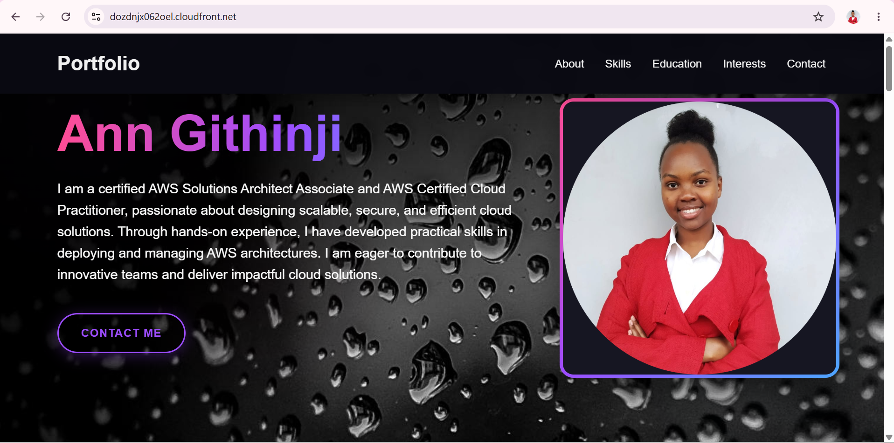
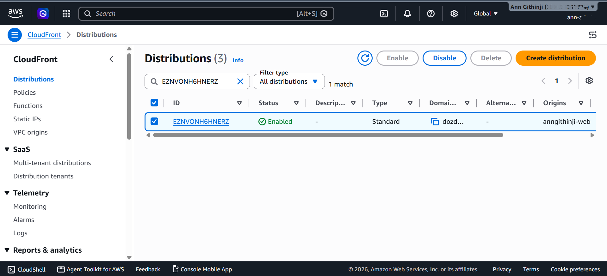
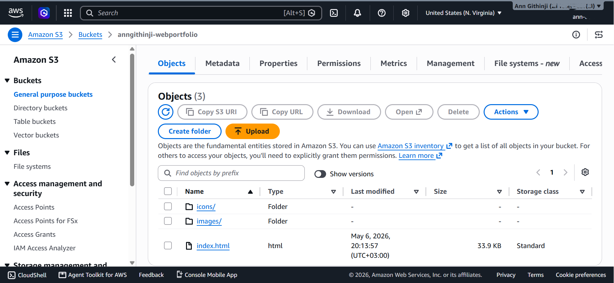
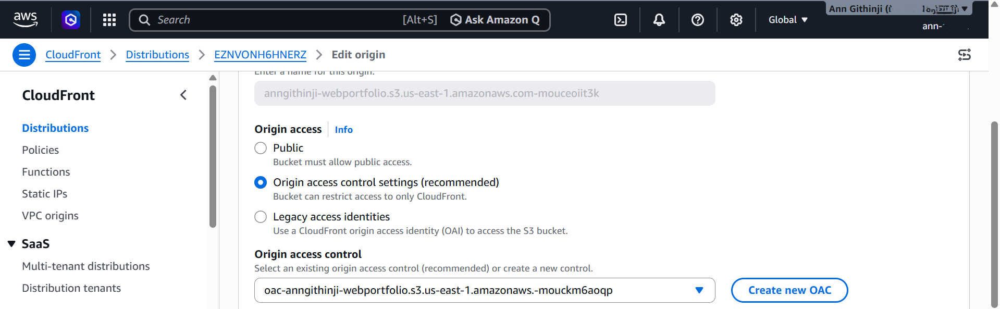

<p align="center">
  <h1 align="center">
      AWS Static Portfolio Website Hosting Architecture
  </h1>

  <p align="center">
      A production-inspired serverless static website hosted on Amazon Web Services using Amazon S3 and Amazon CloudFront.
  </p>
</p>

# Secure Static Portfolio Website Hosting on AWS

> A secure, serverless static website hosting solution built on Amazon Web Services (AWS) using **Amazon CloudFront**, a **private Amazon S3 bucket**, and **Origin Access Control (OAC)**. This repository documents the architecture, deployment process, security implementation, and operational considerations behind the solution.


---

# Table of Contents

* [Project Overview](#project-overview)
* [Project Objectives](#project-objectives)
* [Solution Architecture](#solution-architecture)
* [Architecture Diagram](#architecture-diagram)
* [Architecture Overview](#architecture-overview)
* [Request Flow](#request-flow)
* [Key Features](#key-features)
* [Repository Structure](#repository-structure)
* [Documentation](#documentation)
* [AWS Well-Architected Framework Alignment](#aws-well-architected-framework-alignment)
* [Screenshots](#screenshots)
* [Lessons Learned](#lessons-learned)
* [Future Improvements](#future-improvements)
* [Author](#author)
* [License](#license)

---

# Project Overview

This project demonstrates the design and deployment of a secure, serverless static website architecture on Amazon Web Services (AWS).

Website assets are stored in a **private Amazon S3 bucket** and delivered globally through **Amazon CloudFront**. Access between CloudFront and Amazon S3 is secured using **Origin Access Control (OAC)**, ensuring that website objects cannot be accessed directly from Amazon S3.

The project was developed to gain practical experience with AWS cloud architecture while implementing modern security best practices for static website hosting.

Additional security and reliability enhancements include:

* Amazon S3 Versioning
* Server-Side Encryption using Amazon S3 Managed Keys (SSE-S3)
* Block Public Access
* Origin Access Control (OAC)
* HTTPS content delivery through Amazon CloudFront

This repository serves as both a technical reference and a portfolio project demonstrating practical AWS cloud architecture skills.

User
    │
    ▼
Amazon CloudFront
    │
Origin Access Control (OAC)
    │
    ▼
Private Amazon S3 Bucket

---

# Live Demo

The deployed website is accessible through the Amazon CloudFront distribution.

> https://dozdnjx062oel.cloudfront.net

# Project Highlights

- Secure serverless static website architecture
- Private Amazon S3 bucket protected by Origin Access Control (OAC)
- Global content delivery through Amazon CloudFront
- Block Public Access enabled
- Amazon S3 Versioning for object recovery
- Server-Side Encryption (SSE-S3)
- HTTPS content delivery
- Comprehensive technical documentation

# Project Objectives

The objectives of this project were to:

* Design and deploy a secure serverless static website architecture.
* Implement a private Amazon S3 bucket protected by Origin Access Control (OAC).
* Deliver website content globally using Amazon CloudFront.
* Improve website performance through edge caching.
* Implement Amazon S3 Versioning for data protection.
* Encrypt stored objects using Server-Side Encryption (SSE-S3).
* Apply AWS Well-Architected Framework principles.
* Produce professional technical documentation covering architecture, deployment, security, and operational considerations.

---

# Solution Architecture

The solution follows a fully managed, serverless architecture.

Users access the website through Amazon CloudFront. If the requested content is already cached at an AWS Edge Location, CloudFront returns it immediately.

If the object is not cached, CloudFront securely retrieves it from the private Amazon S3 bucket using **Origin Access Control (OAC)**. The request is authenticated using AWS Signature Version 4 (SigV4), preventing direct public access to the storage layer.

Because the application consists entirely of static assets—including HTML, CSS, JavaScript, images, and icons—no web servers, application servers, or databases are required.

---

# Architecture Diagram

<p align="center">
  
</p>

---

# Architecture Overview

## Amazon S3

Amazon S3 stores all website assets in a private bucket.

The bucket is configured with:

* Block Public Access enabled
* Bucket Owner Enforced object ownership
* Bucket Versioning enabled
* Server-Side Encryption (SSE-S3)
* Private origin accessible only through Amazon CloudFront

---

## Amazon CloudFront

Amazon CloudFront serves as the public entry point for the website.

Responsibilities include:

* Global content delivery
* Edge caching
* HTTPS content delivery
* Reduced latency
* Improved performance
* Secure communication with Amazon S3 using Origin Access Control (OAC)

---

## AWS Identity and Access Management (IAM)

Deployment and administration were performed using an IAM Administrator user.

The AWS account root user was not used for routine administrative activities, following AWS security best practices.

---

# Request Flow

1. A user requests the website.
2. Amazon CloudFront receives the request.
3. CloudFront checks whether the requested object is already cached.
4. If cached, CloudFront immediately returns the object.
5. If not cached, CloudFront signs the origin request using Origin Access Control (OAC).
6. Amazon S3 validates the signed request.
7. Amazon S3 returns the requested object.
8. CloudFront caches the object.
9. CloudFront delivers the object securely to the user over HTTPS.

---

# Key Features

* Secure serverless architecture
* Private Amazon S3 bucket
* Amazon CloudFront Content Delivery Network (CDN)
* Origin Access Control (OAC)
* Block Public Access
* HTTPS content delivery
* Amazon S3 Versioning
* Server-Side Encryption (SSE-S3)
* Low operational overhead
* Cost-effective hosting solution
* Comprehensive technical documentation

---

# Repository Structure

```text
aws-static-portfolio-hosting/
│
├── architecture/
│   ├── architecture.png
│   ├── architecture-description.md
│   └── request-flow.md
│
├── deployment/
│   ├── deployment-guide.md
│   └── configuration.md
│
├── security/
│   └── security.md
│
├── cost/
│   └── cost-estimation.md
│
├── screenshots/
│
├── README.md
├── LICENSE
└── .gitignore
```

---

# Documentation

The project documentation is organized into focused technical references covering the architecture, deployment, configuration, security, request flow, and operational considerations of the solution.

| Document                 | Description                                      |
| ------------------------ | ------------------------------------------------ |
| Architecture Description | Overview of the solution architecture            |
| Request Flow             | End-to-end request lifecycle                     |
| Deployment Guide         | Deployment process and validation                |
| AWS Services Used        | Description of each AWS service                  |
| Configuration Reference  | Final AWS resource configuration                 |
| Security Review          | Security controls and assessment                 |
| Cost Estimation          | Cost drivers and optimization                    |
| Lessons Learned          | Technical insights gained throughout the project |

---

# AWS Well-Architected Framework Alignment

| Pillar                 | Implementation                                                                                         |
| ---------------------- | ------------------------------------------------------------------------------------------------------ |
| Operational Excellence | Structured documentation and repeatable deployment process                                             |
| Security               | IAM administration, Private Amazon S3, Block Public Access, Origin Access Control (OAC), SSE-S3, HTTPS |
| Reliability            | Amazon S3 durability, Versioning, CloudFront global infrastructure                                     |
| Performance Efficiency | CloudFront edge caching and global content delivery                                                    |
| Cost Optimization      | Fully managed serverless architecture                                                                  |
| Sustainability         | Efficient utilization of managed AWS infrastructure                                                    |

---

# Screenshots

## Live Portfolio Website

Demonstrates the successfully deployed static website accessible through Amazon CloudFront.



---

## Amazon CloudFront Distribution

Shows the deployed CloudFront distribution responsible for global content delivery.



---

## Amazon S3 Bucket Configuration

Shows the private Amazon S3 bucket used as the CloudFront origin.



---

## Origin Access Control (OAC)

Demonstrates that Amazon CloudFront securely accesses the private Amazon S3 bucket using Origin Access Control (OAC).



---

# Lessons Learned

This project provided practical experience in designing and deploying a secure serverless architecture on AWS.

Key lessons included:

* Designing secure static website architectures
* Configuring Amazon CloudFront with Origin Access Control (OAC)
* Securing Amazon S3 using Block Public Access
* Writing bucket policies for CloudFront
* Implementing Server-Side Encryption (SSE-S3)
* Using Amazon S3 Versioning for improved recoverability
* Understanding CloudFront edge caching
* Managing CloudFront cache invalidations
* Understanding secure origin access using Amazon CloudFront
* Applying AWS security best practices for static website hosting
* Producing professional cloud architecture documentation

---


# Future Improvements

* [ ] Register a custom domain using Amazon Route 53
* [ ] Configure AWS Certificate Manager (ACM) for the custom domain
* [ ] Automate infrastructure provisioning using Terraform
* [ ] Implement CI/CD using GitHub Actions
* [ ] Enable AWS Web Application Firewall (AWS WAF)
* [ ] Configure Amazon CloudWatch monitoring
* [ ] Enable AWS CloudTrail logging
* [ ] Enable CloudFront access logging
* [ ] Implement AWS Config compliance monitoring

---

# Technical Skills Demonstrated

- Amazon S3
- Amazon CloudFront
- Origin Access Control (OAC)
- AWS Identity and Access Management (IAM)
- Server-Side Encryption (SSE-S3)
- Amazon S3 Versioning
- Cloud Architecture
- Static Website Hosting
- AWS Security Best Practices
- Technical Documentation

# Author

**Ann Githinji**

* AWS Certified Cloud Practitioner
* AWS Certified Solutions Architect – Associate

**Cloud Computing • AWS • Cloud Architecture • Cloud Security • Infrastructure as Code**

---

# License

This project is licensed under the MIT License. See the `LICENSE` file for more information.
