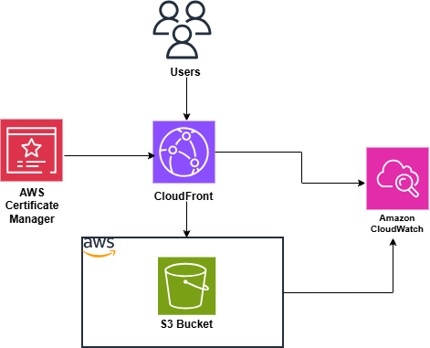

# Architecture Description

## Overview

This document provides a detailed explanation of the architecture used to host the portfolio website on Amazon Web Services (AWS). The solution adopts a serverless architecture that uses fully managed AWS services to deliver static web content with minimal operational overhead.

The architecture is intentionally designed to demonstrate foundational cloud engineering concepts, including secure static content hosting, global content delivery, object versioning, data encryption, and Identity and Access Management (IAM). By relying on fully managed AWS services, while following AWS best practices for hosting static web applications.

---

## Architecture Diagram

<p align="center">
  
</p>

---

## Architectural Design

The solution consists of three primary AWS components that work together to securely deliver static website content to end users.

```
User
   │
   ▼
Amazon CloudFront
   │
   ▼
Amazon S3 Bucket
```

A user's request is first received by Amazon CloudFront. If the requested content is already cached at an edge location, CloudFront serves it immediately. Otherwise, CloudFront securely retrieves the requested object from the Amazon S3 bucket, caches it at the edge location, and returns it to the user.

This architecture improves performance while restricting direct public access to the origin through Amazon CloudFront.

---

# Architecture Components

## Amazon S3

### Purpose

Amazon S3 serves as the origin for the portfolio website and stores all static assets required to render the application.

These assets include:

- HTML pages
- CSS stylesheets
- Images
- Icons
- Other static resources

Because the website does not require server-side processing or a database, Amazon S3 provides an efficient and highly durable storage solution.

### Configuration

The S3 bucket is configured with:

- Bucket Versioning enabled
- Default Server-Side Encryption (SSE-S3) enabled
- Static website assets stored as objects
- A bucket policy that permits object access only from the associated Amazon CloudFront distribution

### Why Amazon S3?

Amazon S3 was selected because it provides:

- High durability (99.999999999%)
- High availability
- Low operational overhead
- Automatic scalability
- Cost-effective object storage
- Secure integration with Amazon CloudFront as a private origin

---

## Amazon CloudFront

### Purpose

Amazon CloudFront functions as the Content Delivery Network (CDN) for the website.

Amazon CloudFront serves as the public entry point for the website. User requests are routed through CloudFront, which securely retrieves objects from the Amazon S3 bucket when they are not already cached at an edge location. This approach improves performance while preventing direct public access to the origin.

### Responsibilities

CloudFront improves the solution by:

- Reducing latency
- Improving page load performance
- Caching frequently requested content
- Reducing requests to the S3 origin
- Providing global content distribution
- Securely accessing the Amazon S3 origin using Origin Access Control (OAC)

### Why CloudFront?

Using CloudFront with a private Amazon S3 origin provides several advantages:

- Faster content delivery
- Better user experience
- Reduced origin traffic
- Improved scalability during traffic spikes
- Prevents direct public access to the Amazon S3 bucket

---

## AWS Identity and Access Management (IAM)

### Purpose

AWS Identity and Access Management (IAM) was used to manage administrative access to the AWS environment throughout deployment and subsequent resource management.

The project was deployed using an IAM Administrator user rather than the AWS root account, following AWS security best practices for day-to-day account management.

Using IAM allows administrative access to be managed separately from the root user while supporting accountability and controlled access to AWS resources.

---

# Architectural Decisions

## Serverless Architecture

A serverless architecture was selected because the website contains only static content and does not require compute resources such as Amazon EC2 or AWS Lambda.

This decision reduces operational complexity while eliminating the need to provision, manage, or patch servers.

---

## Private Amazon S3 Origin

The website assets are stored in a private Amazon S3 bucket that serves as the origin for Amazon CloudFront.

Rather than exposing the bucket directly to the internet, access is restricted through Amazon CloudFront using Origin Access Control (OAC). This approach improves security by ensuring that website content is delivered through the CloudFront distribution rather than by direct access to the S3 bucket.

---

## Bucket Versioning

Bucket Versioning was enabled to improve object durability and simplify recovery from accidental overwrites or deletions.

Maintaining previous versions of objects provides an additional layer of protection during future website updates.

---

## Server-Side Encryption

Default Server-Side Encryption (SSE-S3) was enabled to ensure that all newly uploaded objects are automatically encrypted at rest using Amazon S3 managed encryption keys.

This provides data protection without requiring additional encryption management.

---

# Security Considerations

The architecture incorporates several security controls designed to protect administrative access, stored data, and the origin infrastructure.

- Administrative tasks were performed using an IAM user instead of the AWS root account.
- Server-Side Encryption (SSE-S3) protects stored objects at rest.
- Bucket Versioning improves recoverability of website assets.
- Amazon CloudFront serves as the primary access point for website content.

The Amazon S3 bucket is not publicly accessible. Access to website objects is restricted through a bucket policy that permits requests only from the associated Amazon CloudFront distribution using Origin Access Control (OAC).

This approach follows AWS security best practices by preventing direct access to the origin while ensuring that all website content is delivered through CloudFront.

---

# Scalability

The architecture automatically scales without manual intervention.

Amazon S3 is designed to store virtually unlimited objects, while Amazon CloudFront automatically scales to accommodate increases in user traffic through its globally distributed edge network.

As website traffic grows, no infrastructure changes are required to support additional users.

---

# Reliability

The architecture benefits from the reliability characteristics of managed AWS services.

Amazon S3 provides industry-leading durability for stored objects, while Bucket Versioning improves recoverability in the event of accidental modifications.

Amazon CloudFront improves content availability and resilience by serving cached objects from its globally distributed edge network.

---

# Cost Optimization

The solution minimizes operational costs by using fully managed services.

No virtual machines, databases, or load balancers are required, eliminating ongoing compute costs.

Charges are based primarily on object storage, data transfer, and CloudFront requests, making the solution well suited for personal portfolio websites and low-traffic applications.

---

# Summary

This architecture demonstrates a secure implementation of a serverless static website using managed AWS services. By combining Amazon S3 with Amazon CloudFront and Origin Access Control (OAC), the solution delivers scalable, reliable, and globally distributed content while protecting the origin from direct public access.

Additional capabilities such as Bucket Versioning, Server-Side Encryption (SSE-S3), and secure administration through AWS IAM further strengthen the overall architecture and align the solution with AWS security and operational best practices.